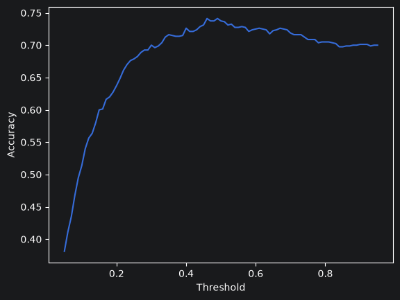
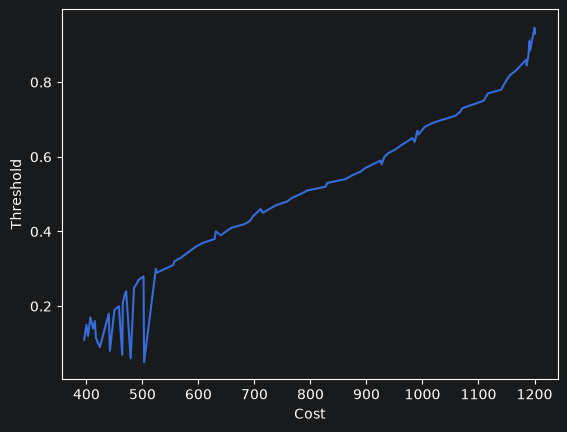

# German Credit Risk Dataset

In this repository, I have explored how data modeling works for credit risk. The following concepts 
have been used:

* Cross validation
* One Hot Encoding
* Logistic Regression
* Weight of Evidence
* Information Value
* Confusion matrix

All the code was implemented using scikit-learn, except Weight of Evidence (WoE) and Information 
Value (IV), which I've implemented from scratch to learn the concept.

I've experimented transforming features from categorical to numerical with One Hot Encoding and WoE.
Both have reached almost the same results in terms of accuracy/cost, although WoE had more advantages
due to the possibility to also explore IV.

With IV, the following features showed more capability to classify the target:

| Feature                  | IV       |
|--------------------------|----------|
| checking_account_status  | 0.609259 |
| credit_history           | 0.262438 |
| duration_months          | 0.213244 |
| purpose                  | 0.149895 |
| employment_since         | 0.124165 |

Different thresholds were tested to minimize the cost, which showed that this dataset presented a
clear trade-off between accuracy and cost minimization as the threshold was changed. High accuracy
often meant high cost:

